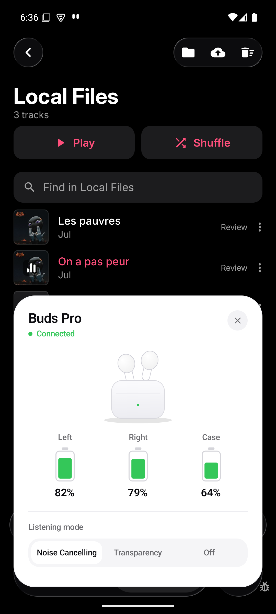
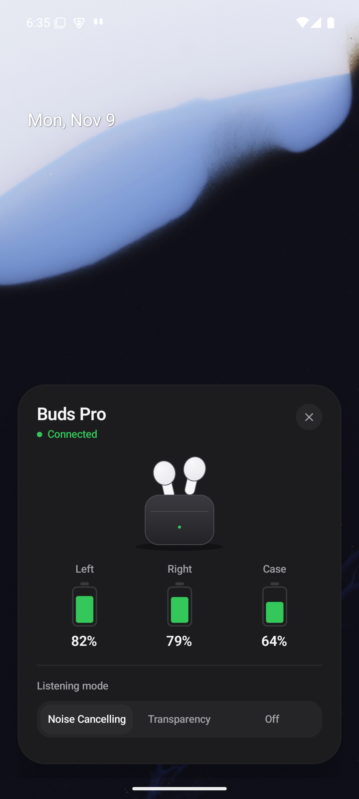

# Buds Companion

> **Language:** English. The app UI is also available in French.

Android companion app built with **Jetpack Compose / Material 3** for Airoha/Flycc
earbuds. The UI is a polished prototype: a home screen and an **AirPods-inspired
connection popup** with left/right/case battery levels and ANC control.

The UI data is still **mocked** (`BudsState`). The RACE protocol core (frame
model, codec, stream parser and serialized command queue), the Android GATT
transport (scan, connection, CCCD, MTU, notifications) and the initialization
sequence (chip, device type, NVDM, role, peer) are implemented. A debug-only
diagnostics screen can request permissions, scan, connect and run the sequence;
wiring the real state into the product UI is the next milestone. The protocol is
documented in [`PROTOCOL.md`](PROTOCOL.md), and the full roadmap is in
[`plan.md`](plan.md).

| Light mode | Dark mode |
|---|---|
|  |  |
|  |  |
|  |  |

The last row is the **debug system overlay**: the same card rendered by
`BudsOverlayService`, above a third-party app (light) and above the launcher
(dark), outside the app.

## Features

- Bottom-anchored floating popup, 32 dp corners, shadow and subtle border.
- Spring entry from the bottom with a fading scrim.
- Background blur via `Modifier.blur` on Android 12+; scrim-only fallback on API 26–30.
- iOS-like battery glyphs with animated fill, green/amber/red depending on level.
- Segmented ANC control (Noise Cancelling / Transparency / Off), shared with the home screen.
- Material 3 light/dark theme, edge-to-edge, custom typography and shapes.
- Popup shown automatically 700 ms after launch; reopened from the hero card or the button.
- Dismissed with the close button, the system back gesture or a tap outside.
- Bilingual UI: **English by default**, **French** through `values-fr`, with Android 13+
  per-app language support.
- Debug-only BLE diagnostics: runtime permissions, filtered scan, connection,
  initialization result and raw TX/RX RACE log.
- Debug system overlay: the popup card in a `TYPE_APPLICATION_OVERLAY` window
  hosted by a `connectedDevice` foreground service (mocked data).
- In-app updates: checks GitHub Releases at launch, downloads the APK with
  progress and opens the system installer — the browser is never used.

## Build

Requirements: JDK 17+ (tested with JDK 21), Android SDK 36 and build-tools 36.0.0.

```bash
# Create this file if missing, using your local SDK path
echo "sdk.dir=/opt/android-sdk" > local.properties

./gradlew :app:assembleDebug
./gradlew :app:installDebug
```

Run the unit tests and lint:

```bash
./gradlew :app:testDebugUnitTest
./gradlew :app:lintDebug
```

The debug APK is generated at `app/build/outputs/apk/debug/app-debug.apk`; the
HTML test report is at `app/build/reports/tests/testDebugUnitTest/index.html`.

## Git workflow

- `main` is **release-only** and must stay stable.
- `develop` is the integration branch.
- Work happens on short-lived `feat/...`, `fix/...`, `chore/...` or `docs/...`
  branches cut from `develop`; pull requests target `develop`.
- Releases merge `develop` into `main` and are tagged `vX.Y.Z`.

See [`AGENTS.md`](AGENTS.md) for the full conventions.

## CI and releases

`.github/workflows/android.yml` runs on pushes and pull requests:
`testDebugUnitTest`, `lintDebug`, `assembleDebug` and `assembleRelease`; both
APKs are uploaded as workflow artifacts.

A `vX.Y.Z` tag additionally publishes a GitHub Release with the tag as its name
and attaches `app-release.apk`. The workflow derives `versionName` from the tag
and `versionCode` as `major * 10000 + minor * 100 + patch`.

The CI release is signed with the Android **debug** key until a release keystore
is configured. That is enough for internal sideloading and for the in-app
updater, but it is not a Play Store signing setup.

At launch the app reads `releases/latest`, compares the tag numerically with
`BuildConfig.VERSION_NAME`, downloads the APK automatically and opens the system
installer. The browser is never used; the user only has to allow installs from
this source once (`REQUEST_INSTALL_PACKAGES`).

## Structure

```
app/src/main/java/com/airbuds/companion/
├── MainActivity.kt              # edge-to-edge + theme
├── data/
│   ├── ble/
│   │   ├── AirohaUuids.kt       # service, TX/RX, CCCD and MTU constants
│   │   ├── BlePermissions.kt    # runtime permission sets by API level
│   │   ├── BudsSession.kt       # init + battery snapshot for the product
│   │   ├── FrameChunker.kt      # split writes to the negotiated MTU
│   │   ├── GattState.kt         # connection state, errors, scan result
│   │   ├── GattTransport.kt     # scan/connect/CCCD/MTU/notifications
│   │   ├── RaceAnc.kt           # 0x0E06 control + 0x0901 state read
│   │   ├── RaceBattery.kt       # 0x0CD6 agent + 0x0D01 partner battery
│   │   ├── RaceCommandQueue.kt  # one command at a time, timeout, retry
│   │   ├── RaceCodec.kt         # single-frame encode/decode
│   │   ├── RaceDeviceInfo.kt    # chip, form factor, role, peer
│   │   ├── RaceFrame.kt         # frame model and size limits
│   │   ├── RaceIds.kt           # command and NVKEY identifiers
│   │   ├── RaceInitializer.kt   # PROTOCOL.md §4 initialization sequence
│   │   ├── RaceParser.kt        # fragment/concatenation reassembly
│   │   ├── RaceTransport.kt     # raw write boundary (implemented by GATT)
│   │   └── YfyBattery.kt        # 0x2100/0x0D case + charging notification
│   ├── repository/
│   │   └── BudsRepository.kt    # connection/init/battery state, error mapping
│   └── update/
│       ├── AppRelease.kt        # GitHub release JSON + APK asset
│       ├── AppUpdateRepository.kt # latest release, download, install
│       └── AppVersion.kt        # numeric tag comparison
├── domain/
│   └── model/
│       ├── BudsBattery.kt       # agent/partner levels, unknown-safe
│       ├── BudsConnection.kt    # disconnected → connecting → ready
│       └── BudsError.kt         # product-level error model
├── model/
│   ├── AncMode.kt               # Noise Cancelling / Transparency / Off
│   └── BudsState.kt             # mocked state (name, battery, ANC, connection)
├── overlay/
│   ├── BudsOverlayService.kt    # debug FGS + WindowManager overlay
│   ├── OverlayLifecycleOwner.kt # lifecycle owner for the ComposeView
│   └── OverlayPermission.kt     # SYSTEM_ALERT_WINDOW check and settings intent
└── ui/
    ├── AncModeLabels.kt         # localized ANC label mapping
    ├── BudsApp.kt               # shared state, auto-show, blur, BackHandler
    ├── DiagnosticsScreen.kt     # debug-only BLE diagnostics UI
    ├── DiagnosticsViewModel.kt  # permissions, scan, connect, init, logs
    ├── HomeScreen.kt            # header, hero card, controls, battery
    ├── BudsPopup.kt             # bottom popup + scrim + animations
    ├── OverlayPopupContent.kt   # mock-state card rendered in the overlay
    ├── UpdateDialog.kt          # in-app update progress/install dialog
    ├── UpdateViewModel.kt       # check, auto-download, install state
    ├── components/
    │   ├── AncSelector.kt       # custom segmented control
    │   ├── Battery.kt           # BatteryPill + BatteryRow
    │   └── BudsIllustration.kt  # Canvas illustration, no image assets
    └── theme/                   # Color, Type, Theme

app/src/main/res/
├── values/strings.xml           # English (default)
├── values-fr/strings.xml        # French
└── xml/locales_config.xml       # per-app language (Android 13+)

app/src/test/java/com/airbuds/companion/data/
├── ble/
│   ├── BudsSessionTest.kt       # init + agent/partner battery snapshot
│   ├── FrameChunkerTest.kt      # MTU-sized write splitting
│   ├── RaceAncTest.kt           # ANC payloads and state parsing
│   ├── RaceBatteryTest.kt       # agent level, relay request/response
│   ├── RaceCodecTest.kt         # encoding, limits, malformed frames
│   ├── RaceInitializerTest.kt   # init sequence, NVKEY routing, device info
│   ├── RaceParserTest.kt        # fragments, concatenation, resync
│   ├── RaceCommandQueueTest.kt  # matching, timeout, retry, serialization
│   └── YfyBatteryParserTest.kt  # 0x2100 battery/charging notification
├── repository/
│   └── BudsRepositoryTest.kt    # attach, refresh, detach, error mapping
└── update/
    ├── AppReleaseParserTest.kt  # release JSON and APK selection
    └── AppVersionTest.kt        # numeric version parsing/comparison
```

## Manual checks (AVD API 30, 1080×2340)

- [x] Popup anchored at the bottom, above the navigation bar, entering from the bottom.
- [x] Popup shown automatically at launch, then dismissible with the close button,
      back or a scrim tap.
- [x] Reopened from the hero card and the button.
- [x] ANC change in the popup reflected immediately on the home screen.
- [x] State (battery, ANC, popup visibility) preserved across rotation.
- [x] Light and dark rendering.
- [x] Scrollable popup in landscape without clipping.
- [x] English UI by default and French UI through the system locale.
- [ ] Background blur to verify on an API 31+ device (not active on the API 30 AVD).

## Manual checks (emulator API 35, 1080×2400)

System overlay (debug):

- [x] Overlay permission requested and granted from the diagnostics screen.
- [x] Notification posted and the `connectedDevice` foreground service started.
- [x] Card visible above the launcher and above a third-party app, anchored to
      the bottom.
- [x] Light and dark rendering of the card.
- [x] Hidden on screens that call `Window.setHideOverlayWindows(true)` (for
      example Settings), which is expected platform behaviour.

## Next steps

1. Validate the GATT and initialization path on a real AB1565 through the debug
   diagnostics screen.
2. Bind the UI to real commands: battery `0x0CD6`, ANC `0x0E06` + state `0x0901`,
   TWS relay `0x0D01`.
3. Add the repository and `ViewModel`, then replace `BudsState` with real state.
4. Turn the diagnostics screen into the production permission and device-picker
   flow.

See [`plan.md`](plan.md) for the complete milestone breakdown.

## Notes

- The product popup is **in-app**. The system-wide behaviour is a **debug spike**
  (`BudsOverlayService`: `TYPE_APPLICATION_OVERLAY` window plus a
  `connectedDevice` foreground service, mocked data). It renders above the
  launcher and third-party apps, but Android hides non-system overlays on
  sensitive screens that call `Window.setHideOverlayWindows(true)` — Settings
  and some permission dialogs, for example — so the popup is not guaranteed
  everywhere.
- In **debug builds**, “Diagnostics (debug)” on the home screen requests the
  BLE permissions, scans (with or without the Airoha service filter), connects,
  runs the initialization and shows the RACE log. The production UI is still
  mocked.
- Product screenshots were captured on the `flycc` AVD (API 30, 1080×2340); the
  system-overlay screenshots on an API 35 emulator (1080×2400).
- English is the primary project language; the app UI also ships a French localization.
