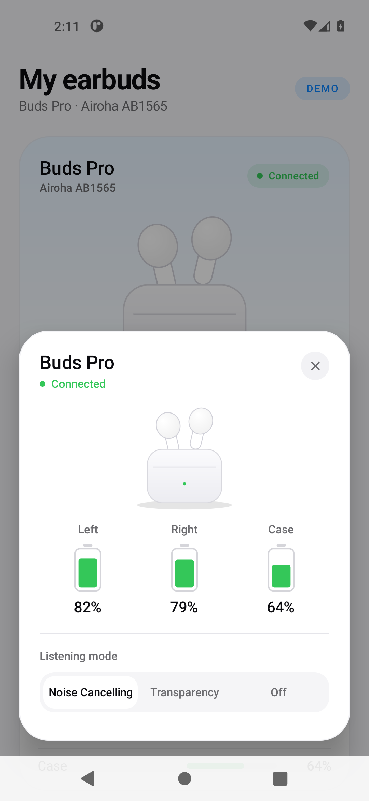
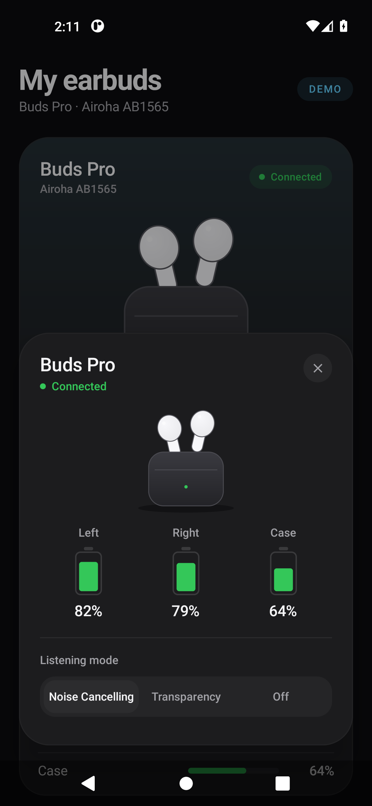
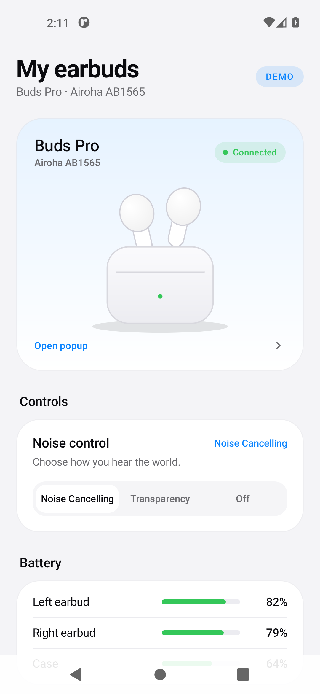
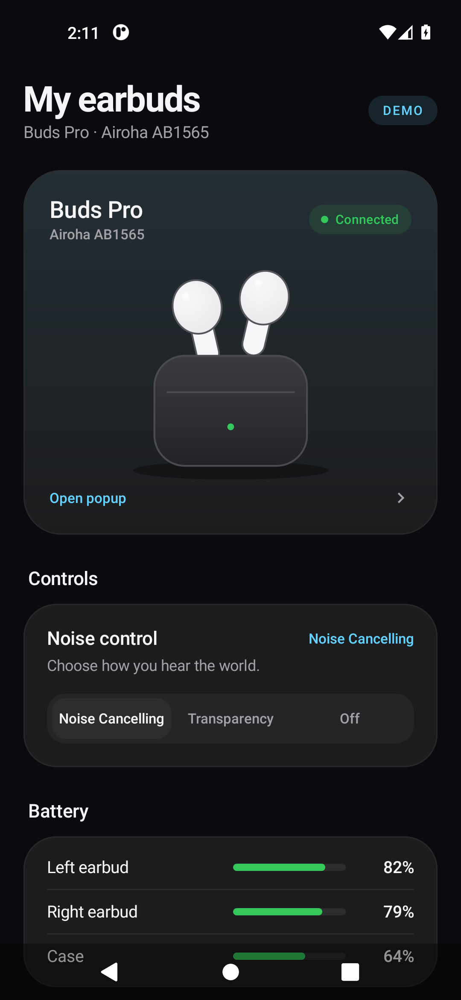

# Buds Companion

> **Language:** English. The app UI is also available in French.

Android companion app built with **Jetpack Compose / Material 3** for Airoha/Flycc
earbuds. The UI is a polished prototype: a home screen and an **AirPods-inspired
connection popup** with left/right/case battery levels and ANC control.

The UI data is still **mocked** (`BudsState`). The RACE protocol core (frame
model, codec, stream parser and serialized command queue) and the Android GATT
transport (scan, connection, CCCD, MTU, notifications) are implemented; the
initialization sequence and UI wiring are the next milestones. The protocol is
documented in [`PROTOCOL.md`](PROTOCOL.md), and the full roadmap is in
[`plan.md`](plan.md).

| Light mode | Dark mode |
|---|---|
|  |  |
|  |  |

## Features

- Bottom-anchored floating popup, 32 dp corners, shadow and subtle border.
- Spring entry from the bottom with a fading scrim.
- Background blur via `Modifier.blur` on Android 12+; scrim-only fallback on API 26–30.
- iOS-like battery glyphs with animated fill, green/amber/red depending on level.
- Segmented ANC control (Noise Cancelling / Transparency / Off), shared with the home screen.
- Material 3 light/dark theme, edge-to-edge, custom typography and shapes.
- Popup shown automatically 700 ms after launch; reopened from the hero card or the button.
- Dismissed with the close button, the system back gesture or a tap outside.
- Bilingual UI: **English by default**, **French** through `values-fr`, with Android 13+
  per-app language support.

## Build

Requirements: JDK 17+ (tested with JDK 21), Android SDK 36 and build-tools 36.0.0.

```bash
# Create this file if missing, using your local SDK path
echo "sdk.dir=/opt/android-sdk" > local.properties

./gradlew :app:assembleDebug
./gradlew :app:installDebug
```

Run the unit tests and lint:

```bash
./gradlew :app:testDebugUnitTest
./gradlew :app:lintDebug
```

The debug APK is generated at `app/build/outputs/apk/debug/app-debug.apk`; the
HTML test report is at `app/build/reports/tests/testDebugUnitTest/index.html`.

## Git workflow

- `main` is **release-only** and must stay stable.
- `develop` is the integration branch.
- Work happens on short-lived `feat/...`, `fix/...`, `chore/...` or `docs/...`
  branches cut from `develop`; pull requests target `develop`.
- Releases merge `develop` into `main` and are tagged `vX.Y.Z`.

See [`AGENTS.md`](AGENTS.md) for the full conventions.

## Structure

```
app/src/main/java/com/airbuds/companion/
├── MainActivity.kt              # edge-to-edge + theme
├── data/
│   └── ble/
│       ├── AirohaUuids.kt       # service, TX/RX, CCCD and MTU constants
│       ├── BlePermissions.kt    # runtime permission sets by API level
│       ├── FrameChunker.kt      # split writes to the negotiated MTU
│       ├── GattState.kt         # connection state, errors, scan result
│       ├── GattTransport.kt     # scan/connect/CCCD/MTU/notifications
│       ├── RaceCommandQueue.kt  # one command at a time, timeout, retry
│       ├── RaceCodec.kt         # single-frame encode/decode
│       ├── RaceFrame.kt         # frame model and size limits
│       ├── RaceParser.kt        # fragment/concatenation reassembly
│       └── RaceTransport.kt     # raw write boundary (implemented by GATT)
├── model/
│   ├── AncMode.kt               # Noise Cancelling / Transparency / Off
│   └── BudsState.kt             # mocked state (name, battery, ANC, connection)
└── ui/
    ├── AncModeLabels.kt         # localized ANC label mapping
    ├── BudsApp.kt               # shared state, auto-show, blur, BackHandler
    ├── HomeScreen.kt            # header, hero card, controls, battery
    ├── BudsPopup.kt             # bottom popup + scrim + animations
    ├── components/
    │   ├── AncSelector.kt       # custom segmented control
    │   ├── Battery.kt           # BatteryPill + BatteryRow
    │   └── BudsIllustration.kt  # Canvas illustration, no image assets
    └── theme/                   # Color, Type, Theme

app/src/main/res/
├── values/strings.xml           # English (default)
├── values-fr/strings.xml        # French
└── xml/locales_config.xml       # per-app language (Android 13+)

app/src/test/java/com/airbuds/companion/data/ble/
├── FrameChunkerTest.kt          # MTU-sized write splitting
├── RaceCodecTest.kt             # encoding, limits, malformed frames
├── RaceParserTest.kt            # fragments, concatenation, resync
└── RaceCommandQueueTest.kt      # matching, timeout, retry, serialization
```

## Manual checks (AVD API 30, 1080×2340)

- [x] Popup anchored at the bottom, above the navigation bar, entering from the bottom.
- [x] Popup shown automatically at launch, then dismissible with the close button,
      back or a scrim tap.
- [x] Reopened from the hero card and the button.
- [x] ANC change in the popup reflected immediately on the home screen.
- [x] State (battery, ANC, popup visibility) preserved across rotation.
- [x] Light and dark rendering.
- [x] Scrollable popup in landscape without clipping.
- [x] English UI by default and French UI through the system locale.
- [ ] Background blur to verify on an API 31+ device (not active on the API 30 AVD).

## Next steps

1. Initialization: NVKEY 4098 → 4097, device type, role `0x0CC4`,
   available destinations `0x0D00`.
2. Runtime permission flow and scan/device-selection screen, then connect the
   UI to `GattTransport`.
3. Bind the UI to real commands: battery `0x0CD6`, ANC `0x0E06` + state `0x0901`,
   TWS relay `0x0D01`.
4. Add the repository and `ViewModel`, then replace `BudsState` with real state.

See [`plan.md`](plan.md) for the complete milestone breakdown.

## Notes

- The popup is **in-app**, not a system overlay: Android cannot exactly replicate the
  iOS system popup above other apps without a service and `SYSTEM_ALERT_WINDOW`.
- BLE permissions are declared, but the runtime request flow and the device picker
  are not implemented yet; the app still shows mocked state.
- Screenshots were captured on the `flycc` AVD (API 30, 1080×2340).
- English is the primary project language; the app UI also ships a French localization.
